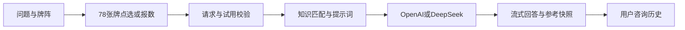

# 塔罗指引：知识参考与咨询记忆

基于 Indigo Qiu 的 [indigo-tarot](https://github.com/HammerRoot/indigo-tarot) 二次开发的全栈AI咨询演示。保留根目录LICENSE（CC BY-NC 4.0）与原作者署名；不是从零原创，也不是训练过的塔罗模型。素材来源与未解决项见 [来源清单](THIRD_PARTY_NOTICES.md)，商业使用需另行核实授权。

## 功能与贡献范围

原项目提供Next.js/React基础界面、78张牌、点选抽牌和模型流式解读。本版本扩展：

- 18种牌阵图鉴与逐牌位教学，支持点选或输入1至78的不同数字。
- 按领域、牌ID、正逆位和牌位匹配知识；78张牌的624条领域笔记及24条教学摘要；结果、追问和历史保存本次参考快照。
- 用户名注册与登录、最多50条服务端咨询记录、原牌组连续追问和主动选择历史参考。
- OpenAI与DeepSeek配置、本机开发者知识管理、设备与账号试用账本、每日硬限额。
- 墨绿暖金主题、合成音效、音量与简化动画，系统减少动画设置优先。

使用AI辅助开发，贡献应结合代码与提交记录说明；不宣称上游功能为独立原创、保证预测准确或心理疗效。参考资料进入请求不保证模型忠实采用，需要审查输出。

## 技术与数据流

React 19、Next.js 16、TypeScript、Tailwind CSS 4、Framer Motion、Zustand、Web Audio、Vitest/Testing Library。模型通过服务端fetch调用，SSE格式流式返回；检索是结构化条件筛选与评分，没有向量数据库或模型微调。

字体使用系统字体栈，生产构建不再下载Google Fonts；网络仍用于首次安装依赖与真实模型调用。私有运行目录排除在测试、类型/代码检查及部署文件追踪之外。



这是单机应用：账号、知识库、密钥配置与持久试用账本使用私有JSON文件。Redis只用于可选的原限流/计数层，不能替代上述文件或提供多实例协调。部署与配置见 [DEPLOYMENT](docs/DEPLOYMENT.md)，当前运维记录见 [OPERATIONS](docs/OPERATIONS.md)。

## 快速开始

完整开发/测试环境建议Node.js 24.15+或26+（jsdom要求）；当前本机24.14.1可运行，但安装会提示引擎版本警告；npm与package-lock.json保持一致。

```bash
git clone <your-repository-url>
cd <your-repository-directory>
npm ci
cp .env.example .env.local
npm run dev
```

Windows PowerShell复制配置：

```powershell
Copy-Item .env.example .env.local
```

打开 http://localhost:3000。不配置Redis即可使用界面、抽牌与牌义手册。个人API Key可在页面设置；系统Key可通过私有环境变量或开发者后台配置。不填任何Key时无法AI解析，不能将其宣传为默认提供免费模型服务。

开发者后台没有默认账号。需要时设置DEVELOPER_USERNAME和DEVELOPER_PASSWORD，首次密码至少12字符。账号配置留空时新部署不启用后台登录。不要把真实值提交Git；全部变量与初始化/备份限制见 [.env.example](.env.example) 与部署文档。

## 验证与生产运行

```bash
npm run type-check
npm run test:run -- --maxWorkers=2
node scripts/test-public-proxy.cjs
npm run build
npm run start -- --hostname 127.0.0.1 --port 3000
```

GitHub Actions执行类型检查、测试、代理权限自检和构建；仓库尚未发布时不能宣称CI已在GitHub运行。历史验收数字见 [SPEC](docs/SPEC.md)，本轮独立安装与发布检查见 [报告](docs/reports/PUBLICATION-READINESS-2026-10-13.md)。测试通过不证明模型回答准确或高并发能力。

## 使用与权限边界

输入问题 → 选择牌阵并查看牌位 → 点选或报数抽牌 → 生成解读 → 展开参考依据。后续可在历史中继续咨询，沿用原牌组。每次生成和追问均可能产生模型费用；流式中断不保证退款。

用户名英文不区分大小写，未注册名字不能直接登录。**用户名没有密码，知道名字就能查看其历史**，不适合敏感咨询或需要强身份认证的多人服务。游客历史留在浏览器，登录后保存到服务端；退出清除账号缓存，不删除服务端历史。模型不会自动读取全部历史，只使用本轮选择的上下文。

一次系统试用按设备和账号联合检查，成功开始生成即计入；浏览器标识可被清除或伪造，不是硬件绑定。私有账本正常重启保留试用与每日硬限额，不能说不配Redis就会重置这些记录。未配置系统Key时需使用自己的Key。

## API与隐私

- POST `/api/deepseek-stream`：prompt、可选userApiKey/model/knowledgeRequest；流式meta、content、complete事件，错误用对应HTTP状态。资料快照随元信息返回。
- GET `/api/trial-status`：携带X-Device-Id，查询实际试用状态。
- GET/POST `/api/user-memory`：用户名注册/登录/退出及本人的咨询记录。
- `/api/developer`、`/api/knowledge`：开发者管理，公开分享通过白名单代理隔离管理写入。
- GET `/api/health`：服务健康；Redis配置错误可能返回503。

问题、牌面、背景、参考资料及追问上下文发送给所选模型供应商。系统Key留在服务端加密配置中；个人Key按用户选择保留会话或加密浏览器存储，浏览器加密不能防止运行中的恶意脚本/扩展。服务端账号记录包含问题和回答，匿名调用统计与咨询历史是不同的数据，不应说服务器完全不保存问题。

不发布.env.local、.local、用户历史、ngrok token、教学原图。详细边界见 [SECURITY](SECURITY.md)。公开分享依赖本机在线，GitHub仅放代码不会使网站一直可用。

## 演示、贡献与许可

界面截图见 [视觉验收](docs/reports/FOREST-THEME-2026-10-13.md)，演示流程和面试解释见 [作品说明](docs/PORTFOLIO.md)。素材授权缺口仍在 [来源清单](THIRD_PARTY_NOTICES.md)，不是全部权属已获验证的声明。

欢迎针对二次开发版本提供问题和修复：创建feature/或bug-fix/分支，附复现与相应检查，提交到该版本实际发布的仓库。上游链接表示来源，不代表上游作者维护此版本或为新增功能背书。不得在公开Issue贴真实Key或用户咨询；安全报告见SECURITY.md。

根目录LICENSE与第三方许可保持。修改配色不能让继承代码变为从零原创；请注明来源和改动，不将整个项目擅自重新标为MIT。
