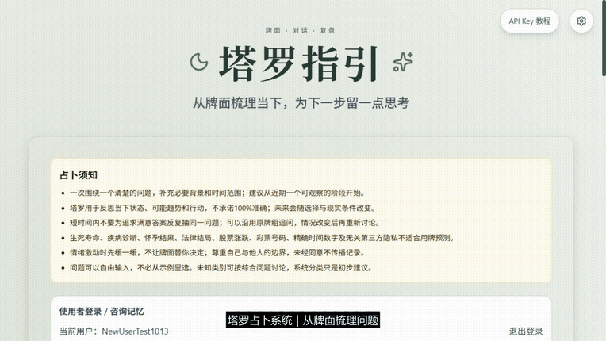
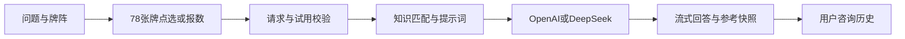

# 塔罗占卜系统

基于 Indigo Qiu 的 [indigo-tarot](https://github.com/HammerRoot/indigo-tarot) 二次开发的全栈AI咨询演示。素材来源与未解决项见 [来源清单](THIRD_PARTY_NOTICES.md)，商业使用需另行核实授权。

## 项目介绍

这是一个可以在本地运行的塔罗问答应用。用户自由输入感情、学业、事业等问题，选择牌阵并按牌位抽牌，再用自己的 OpenAI 或 DeepSeek API Key 获取解读。系统把本次问题、牌面、正逆位、牌位和匹配的知识资料一起提供给模型，结果页展示解读及资料参考，方便复盘。

本版本在上游项目基础上扩展了以下体验：

- **先教牌阵，再抽牌**：18种牌阵提供牌位说明，支持78张牌点选和报数两种方式。
- **回答有参考材料**：按问题领域与牌面匹配知识条目，保存并展示本次资料快照；资料传入不保证模型完整遵循。
- **咨询可以接着聊**：用户名登录后保存最近50条咨询，也能沿用原牌组追问，主动选择旧咨询作为参考。
- **个人 Key 与管理分开**：使用者配置自己的模型和Key，开发者管理系统配置与知识条目；抽牌提供音效和简化动画设置。

工程上采用 Next.js/React/TypeScript、结构化知识检索和 SSE 流式返回；当前没有模型训练、微调或向量数据库。它适合体验交互和学习大模型应用开发，解读用于娱乐与反思，不代表确定预测。用户名无密码的访问边界见下方说明。

## 演示视频

下方为4倍速动图预览。**[观看或下载完整演示视频（MP4，约61秒）](docs/demo/tarot-demo.mp4)**，点击动图也可打开视频文件；若GitHub页面只显示下载按钮，下载后用浏览器或播放器打开。

[](docs/demo/tarot-demo.mp4)

演示流程：自由提问 → 牌阵教学 → 报数抽牌 → 真实DeepSeek解读 → 展开知识参考 → 历史同步。本次使用测试账号和测试问题，实际调用一次 `deepseek-flash`，没有展示API Key或真实用户咨询。视频为真实界面关键画面与翻牌片段剪辑，中文字幕、无旁白，等待与转场缩短；完整制作说明见 [演示素材说明](docs/demo/README.md)。

## 从哪里开始看

首次运行看下方快速开始；了解架构和贡献看 [作品说明](docs/PORTFOLIO.md)；各类检查结果看 [报告导航](docs/reports/README.md)。代码保存在私有仓库 [tarot-divination-system](https://github.com/bowenx148-cmyk/tarot-divination-system)，中文展示名为“塔罗占卜系统”。

```text
app/          页面、组件与API路由
lib/          抽牌、知识检索、状态和服务端逻辑
public/       牌图等静态资源
tests/        跨模块测试；组件测试保留在对应源码附近
scripts/      启动、分享和验证脚本
docs/
  knowledge/  知识来源与说明
  reports/    publication/发布检查  research/调研
              interface/视觉验收    operations/运行说明
  archive/    历史规格与工程记录
  plan/       尚未执行或正在执行的事项
.github/      自动检查工作流
```

根目录保留README、LICENSE、安全/来源说明和框架配置；不将密钥、运行数据、依赖或构建产物放进仓库。

## 功能与贡献范围

原项目提供Next.js/React基础界面、78张牌、点选抽牌和模型流式解读。本版本扩展：

- 18种牌阵图鉴与逐牌位教学，支持点选或输入1至78的不同数字。
- 按领域、牌ID、正逆位和牌位匹配知识；78张牌的624条领域笔记及24条教学摘要；结果、追问和历史保存本次参考快照。
- 用户名注册与登录、最多50条服务端咨询记录、原牌组连续追问和主动选择历史参考。
- OpenAI与DeepSeek配置、本机开发者知识管理、设备与账号试用账本、每日硬限额。
- 墨绿暖金主题、合成音效、音量与简化动画，系统减少动画设置优先。

使用AI辅助开发，贡献应结合代码与提交记录说明；不宣称上游功能为独立原创、保证预测准确或心理疗效。参考资料进入请求不保证模型忠实采用，需要审查输出。

## 技术与数据流

React 19、Next.js 16、TypeScript、Tailwind CSS 4、Framer Motion、Zustand、Web Audio、Vitest/Testing Library。模型通过服务端fetch调用，SSE格式流式返回；检索是结构化条件筛选与评分，没有向量数据库或模型微调。

字体使用系统字体栈，生产构建不再下载Google Fonts；网络仍用于首次安装依赖与真实模型调用。私有运行目录排除在测试、类型/代码检查及部署文件追踪之外。



这是单机应用：账号、知识库、密钥配置与持久试用账本使用私有JSON文件。Redis只用于可选的原限流/计数层，不能替代上述文件或提供多实例协调。部署与配置见 [DEPLOYMENT](docs/DEPLOYMENT.md)，当前运维记录见 [OPERATIONS](docs/OPERATIONS.md)。

## 本地部署与打开方式

本项目需要先启动 Node.js 服务，再通过浏览器使用。下载代码后不能直接双击 HTML 文件运行。以下步骤是在**使用者自己的电脑**上执行；启动后打开的 `localhost` 也是这台电脑，不是项目作者的电脑。GitHub 仓库地址用于下载代码，不是在线占卜网址。

### 1. 准备环境

安装 [Node.js](https://nodejs.org/) 和 [Git](https://git-scm.com/)。Node.js 使用 **24.15.0 及以上的 24.x 版本，或 26 及以上版本**，与 package.json 的 engines 要求一致；npm 随 Node.js 一起安装。安装完成后重新打开终端，检查：

```bash
node --version
npm --version
git --version
```

Windows 可以使用 PowerShell 或命令提示符。若 PowerShell 提示禁止运行 npm.ps1，下文所有 npm 命令都使用 `npm.cmd`，无需修改系统执行策略。本地单实例使用不必安装 Redis 或数据库；安装依赖和调用 AI 需要网络连接。

### 2. 下载代码

在你想保存项目的文件夹中打开终端，执行：

```bash
git clone https://github.com/bowenx148-cmyk/tarot-divination-system.git
cd tarot-divination-system
```

如果仓库为私有，需先请维护者邀请你的 GitHub 账号，接受邀请后再下载；出现 404 或 Repository not found 时先检查账号权限。Git 提示登录时，在官方登录页面完成验证。

也可以在已获访问权限的 GitHub 仓库页面点击 **Code → Download ZIP**，解压后进入包含 `package.json` 的文件夹，再打开终端。从 ZIP 下载无需 Git；后续安装、配置和启动步骤相同。

### 3. 安装、配置并启动

**Windows PowerShell / 命令提示符：** 在项目文件夹中依次执行，上一条成功后再执行下一条。

```powershell
npm.cmd ci
Copy-Item .env.example .env.local
npm.cmd run build
npm.cmd run start -- --hostname 127.0.0.1 --port 3000
```

其中 `Copy-Item` 是 PowerShell 命令；如果使用命令提示符，把这一行换成 `copy .env.example .env.local`。`.env.local` 只在首次安装时复制；已经配置过的文件不要覆盖。使用个人 API Key 时，里面的系统密钥、开发者账号和 Redis 配置都可以留空。

**macOS / Linux：**

```bash
npm ci
cp .env.example .env.local
npm run build
npm run start -- --hostname 127.0.0.1 --port 3000
```

首次构建需要等待。终端出现 `Ready`，并显示地址 `http://127.0.0.1:3000`，表示服务已启动。此时保持终端运行，在浏览器打开：

**[http://localhost:3000](http://localhost:3000)**（也可以用 [http://127.0.0.1:3000](http://127.0.0.1:3000)）。

不要把这个地址发给别人作为公网链接；别人的 `localhost` 指向他们自己的电脑。当前启动命令只允许本机访问，公网部署另见 [部署文档](docs/DEPLOYMENT.md)。

### 4. 配置自己的 API Key 并开始使用

1. 打开首页，在“使用者登录 / 咨询记忆”中注册用户名；下次输入同一个用户名登录，英文不区分大小写。也可作为游客使用，游客历史仅保存在本浏览器。
2. **先注册或登录，再配置 Key。** 注册、退出或切换账号会清除当前个人 Key，避免共用设备串用密钥。
3. 点击右上角 **API设置**，在“AI 服务与模型”中选择供应商和模型。例如 DeepSeek 选择 `deepseek-flash`，OpenAI 选择 `gpt-5.4-mini`；填写同一供应商的有效 API Key。弹窗内“配置教程”提供获取与填写方法。
4. 点击“保存”。Key 的账户需要有可用 API 额度或余额；网页聊天订阅不代表具备 API 调用额度。个人 Key 的费用由你自己的供应商账户承担。
5. 输入问题，选择牌阵并查看牌位说明，使用点选或报数抽牌，确认牌组后点击“开始解析”。正常情况下结果页会逐步显示“核心建议”“AI 深度解析”和本次知识参考。
6. 登录用户可在“历史记录”恢复此前的咨询。本地部署的账号与历史保存在本次项目的 `.local` 目录；保留该目录才能保留记录，下载另一份代码不会自动带入原来的历史。

新下载的项目不包含作者的系统 Key；**没有配置任何 Key 时，不能生成 AI 解读**。系统免费试用只有在部署者配置系统 Key 后才能实际调用。关闭“在本设备记住 Key”后，刷新页面需要重新输入。

### 5. 下次打开与停止

下次使用时，在同一个项目文件夹打开终端，Windows 执行：

```powershell
npm.cmd run start -- --hostname 127.0.0.1 --port 3000
```

macOS / Linux 使用对应的 `npm run start -- --hostname 127.0.0.1 --port 3000`。启动后仍在浏览器打开 [http://localhost:3000](http://localhost:3000)。代码或依赖更新后需按更新内容重新安装依赖、执行 `npm run build` 再启动；单纯再次使用不需要每次安装和构建。

终端按 **Ctrl+C** 可停止服务。终端关闭或电脑关机后，网页就无法继续调用本地服务；下次启动即可继续使用保留下来的记录。

需要修改代码时，可以使用 `npm run dev` 启动开发模式，浏览器地址以终端显示为准；普通使用者按上面的构建与启动步骤即可。

### 常见问题

| 现象 | 处理方法 |
|---|---|
| 仓库 404 / Repository not found | 检查 GitHub 账号是否有私有仓库权限，并确认已经接受邀请。 |
| 找不到 node / npm / git | 完成安装后重新打开终端；检查安装程序是否加入 PATH。 |
| 提示 EBADENGINE | 用 `node --version` 检查版本，安装满足上述 engines 要求的 Node.js。 |
| 提示找不到 package.json | 终端应位于包含 `package.json` 的项目根目录，不是外层解压文件夹。 |
| 提示 Could not find a production build | 先执行 `npm run build`，成功后再运行 `npm run start`。 |
| 3000 端口被占用 / EADDRINUSE | 改用 `npm run start -- --hostname 127.0.0.1 --port 3006`，然后打开 `http://localhost:3006`；Windows 使用 `npm.cmd`。 |
| 浏览器打不开本地地址 | 确认终端服务仍在运行、已经出现 Ready，浏览器端口与启动命令一致。 |
| 提示未配置密钥 / Key 无效 / 余额不足 | 登录后重新检查 API设置、供应商、Key 和 API 账户余额；保留原牌组重试，无需重新抽牌。 |

如需启用开发者后台，设置 `.env.local` 中的 `DEVELOPER_USERNAME` 和 `DEVELOPER_PASSWORD`，首次密码至少12字符；新部署没有默认开发者账号。重启服务后打开 [http://localhost:3000/developer](http://localhost:3000/developer)。所有变量与备份要求见 [.env.example](.env.example) 和 [部署文档](docs/DEPLOYMENT.md)，不要把真实配置提交到 GitHub。

## 验证与生产运行

```bash
npm run type-check
npm run test:run -- --maxWorkers=2
node scripts/test-public-proxy.cjs
npm run build
npm run start -- --hostname 127.0.0.1 --port 3000
```

GitHub Actions执行类型检查、测试、代理权限自检和构建；实际结果见仓库的 [Actions](https://github.com/bowenx148-cmyk/tarot-divination-system/actions)。历史验收数字见 [SPEC](docs/SPEC.md)，本轮独立安装与发布检查见 [报告](docs/reports/publication/PUBLICATION-READINESS-2026-10-13.md)。测试通过不证明模型回答准确或高并发能力。

## 使用与权限边界

输入问题 → 选择牌阵并查看牌位 → 点选或报数抽牌 → 生成解读 → 展开参考依据。后续可在历史中继续咨询，沿用原牌组。每次生成和追问均可能产生模型费用；流式中断不保证退款。

用户名英文不区分大小写，未注册名字不能直接登录。**用户名没有密码，知道名字就能查看其历史**，不适合敏感咨询或需要强身份认证的多人服务。游客历史留在浏览器，登录后保存到服务端；退出清除账号缓存，不删除服务端历史。模型不会自动读取全部历史，只使用本轮选择的上下文。

一次系统试用按设备和账号联合检查，成功开始生成即计入；浏览器标识可被清除或伪造，不是硬件绑定。私有账本正常重启保留试用与每日硬限额，不能说不配Redis就会重置这些记录。未配置系统Key时需使用自己的Key。

## API与隐私

- POST `/api/deepseek-stream`：prompt、可选userApiKey/model/knowledgeRequest；流式meta、content、complete事件，错误用对应HTTP状态。资料快照随元信息返回。
- GET `/api/trial-status`：携带X-Device-Id，查询实际试用状态。
- GET/POST `/api/user-memory`：用户名注册/登录/退出及本人的咨询记录。
- `/api/developer`、`/api/knowledge`：开发者管理，公开分享通过白名单代理隔离管理写入。
- GET `/api/health`：服务健康；Redis配置错误可能返回503。

问题、牌面、背景、参考资料及追问上下文发送给所选模型供应商。系统Key留在服务端加密配置中；个人Key按用户选择保留会话或加密浏览器存储，浏览器加密不能防止运行中的恶意脚本/扩展。服务端账号记录包含问题和回答，匿名调用统计与咨询历史是不同的数据，不应说服务器完全不保存问题。

不发布.env.local、.local、用户历史、ngrok token、教学原图。详细边界见 [SECURITY](SECURITY.md)。公开分享依赖本机在线，GitHub仅放代码不会使网站一直可用。

## 演示、贡献与许可

界面截图见 [视觉验收](docs/reports/interface/FOREST-THEME-2026-10-13.md)，演示流程和面试解释见 [作品说明](docs/PORTFOLIO.md)。素材授权缺口仍在 [来源清单](THIRD_PARTY_NOTICES.md)，不是全部权属已获验证的声明。

欢迎针对二次开发版本提供问题和修复：创建feature/或bug-fix/分支，附复现与相应检查，提交到该版本实际发布的仓库。上游链接表示来源，不代表上游作者维护此版本或为新增功能背书。不得在公开Issue贴真实Key或用户咨询；安全报告见SECURITY.md。

根目录LICENSE与第三方许可保持。修改配色不能让继承代码变为从零原创；请注明来源和改动，不将整个项目擅自重新标为MIT。
欢迎大家下载并且使用，项目会保持更新和维护，如果有啥好的意见的话可以发到我的个人邮件22257054@qq.com 
