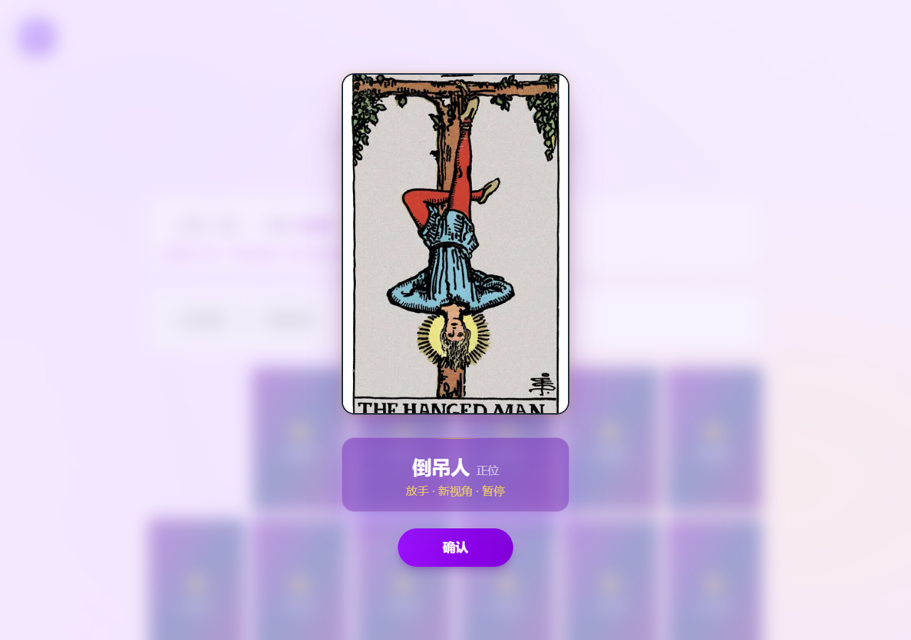
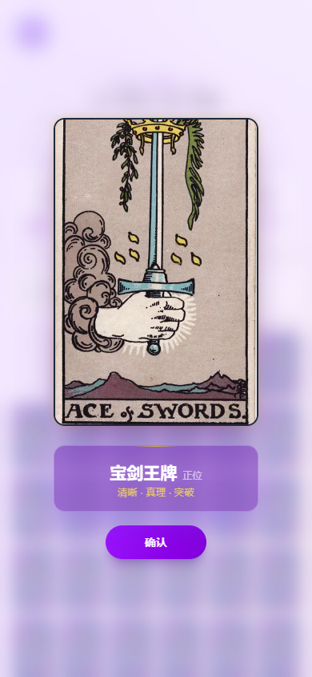

# 塔罗项目：解读改进、求职展示、开源与盈利

本文负责本次调研结论、产品判断和来源说明。工程验收见 [本次完成记录](../archive/night-upgrade.md)；后续执行规格见 [求职与商业验证路线](../plan/portfolio-commercial-roadmap.md)。调研日期：2026-10-09至10日。建议、试验假设和已实现功能分别注明，不冒称真实营收或用户评价。

## 先说结论

这个项目值得继续做。求职时应展示你怎样把一个公开塔罗项目改造成带知识检索、咨询记忆、流式解读和完整抽牌体验的应用。商业上先解决授权，再试单次交付；暂时没有收入数据，不能证明有人会持续付费。不要在简历上说“从零训练塔罗大模型”“千万级用户系统”或“占卜准确率提升”。

最大现实限制是本地仓库根目录 [LICENSE](../../LICENSE) 声明 CC BY-NC 4.0，包含非商业条件。增加自己的代码不会自动解除上游条件。CC 官网也明确列出非商业与署名要求；商业发布应取得权利人的许可，或采用经过权属确认的独立实现及素材。这里是产品决策依据，不是针对具体交易的法律意见。[CC BY-NC 4.0](https://creativecommons.org/licenses/by-nc/4.0/)

## 你和学长的讨论，落实成什么

你担心“接了 API，之前给的资料去了哪里”；学长提醒检查解读 prompt、加强提示词、认真调表达。这两个问题应分别解决。

资料方面，每次请求会按问题类别、抽出的牌、正逆位和牌位选出笔记，附在模型输入中。结果和历史保存当时的参考快照。这叫基于资料的检索增强，当前用结构化条件匹配，未使用向量数据库，也未改变模型权重。资料出现在输入里不保证模型完全遵守，所以需要检查实际输出。

表达方面，本次保留原解析协议，减少正文中的机械小标题；要求第一句就给出倾向，随后解释关键牌位的支持或牵制关系。直接可以是“有靠近机会，但推进偏慢”，而不是每次都说“保持开放、照顾情绪”。对未提供的事实保留边界，不靠断言对方内心来制造专业感。

新加入24条原创中文教学摘要及领域应用笔记，覆盖牌位、逆位、宫廷牌、感情、学业、收入、事业、人际、家庭、成长和情绪关照，并加强月亮、倒吊人、圣杯二等你实际抽过的牌。原有78张牌及624条正逆位领域笔记保留。后台可编辑、停用和导入；实际启用资料以后台为准。

Humanizer 的价值在于删模板、浮夸词和重复句，并保留具体判断，不能当成“去 AI 检测器”。本次沿用已安装技能的编辑原则，没有额外加入一次收费模型改写。[Humanizer 项目](https://github.com/blader/humanizer)

## 教学和同类项目学到了什么

| 一手材料 | 本次取用 | 应用边界 |
|---|---|---|
| Joan Bunning Lesson 16 | 比较互相支撑或牵制的牌位 | 按本网站实际位置定义读牌，不把其他牌阵定义照搬过来 |
| Lesson 17 | 逆位可体现减弱或尚未充分展开 | 不把逆位一律说成坏事；不采用原文的怀孕预测例子 |
| Lesson 14、18 | 宫廷牌的角色视角、整组解读的组织方法 | 不据此推断年龄、性别或超自然事实 |
| CNVC 公开介绍 | 观察与判断分开，尊重对方选择 | 用于表达与沟通建议，不宣称治疗能力 |

这些是方法启发和自编应用，不是完整教材复制，也不是预测准确性的证据。[牌位关系](https://www.learntarot.com/less16.htm)、[逆位](https://www.learntarot.com/less17.htm)、[宫廷牌](https://www.learntarot.com/less14.htm)、[整组组织](https://www.learntarot.com/less18.htm)、[CNVC](https://www.cnvc.org/about/purpose-of-nvc)

GitHub 的 Mystic-Draw 展示了翻牌、粒子和音效开关的结合。本次借鉴体验思路，自行实现短音效与样式，没有下载它的音频或卡牌。Web Audio 应由用户交互解锁并提供音量控制；系统减少动态效果应得到尊重，因此默认静音，并保留简化动画。[Mystic-Draw](https://github.com/datturbomoon/Mystic-Draw)、[MDN 音频实践](https://developer.mozilla.org/en-US/docs/Web/API/Web_Audio_API/Best_practices)、[Motion 减少动画](https://motion.dev/docs/react-use-reduced-motion)

Promptfoo 提供固定用例比较提示词和模型的工具思路。本轮没有为了几个检查安装整套工具；保留实际输出与资料快照，人工检查直接程度、牌位覆盖、无虚构和资料应用。单元测试通过不能证明“像真人”。[Promptfoo](https://github.com/promptfoo/promptfoo)

## 国内和海外：实际查到的内容

本次做了两轮、共六次真实DeepSeek请求，覆盖七牌感情、三牌学业和三牌收入。第二轮把多次来源插入改成末尾一次，收入输出从1027字符降到691字符；三组实际请求分别带入15、11、10条参考。原始最终回答见 [模型样本](REAL-MODEL-SAMPLES-2026-10-10.md)。这是小样本调试记录，不是盲测或统计质量提升。仍能看到偏长句、个别“说明你……”的确定口吻；不能说已完全像真人，也不能把建议篇幅当成强制长度保证。

抖音公开教学页面有明确表达边界：趋势不应说成宿命，建议不应变成命令。这与本项目方向一致。另一个公开视频的评论里，用户反复要求“清晰、有逻辑”的解释；它只能说明该页面出现过这种诉求，不能证明整个市场的需求规模。未获取完整视频字幕，不宣称观看并消化了全部教学。[教学表达](https://jingxuan.douyin.com/m/video/7673876936241777930)、[报数互动样本](https://www.douyin.com/video/7680575040438125747)

抖音公约列有封建迷信、伪科学相关限制。因此不要把能看到别人的塔罗视频，理解为所有塔罗商品、广告、挂载或导流都获准。平台审核要按具体内容、场景和类目核验。小红书本轮未拿到可核验的经验笔记原文，不能给出“别人月入多少”的可信结论，也未读取你的浏览器登录资料。[抖音公开公约](https://lf3-cdn-tos.draftstatic.com/obj/ies-hotsoon-draft/douyin_creator/40db1b96-0eb0-4754-a052-16e8325af350.html)

海外有不同交付方式。Etsy 的现行服务政策允许符合规则、含照片、文字或音视频交付的占卜阅读，标题同时强调不宣传形而上结果；这不能推导成网站会员订阅也允许出售。Fiverr 的公开卖家页面提供一问五牌视频交付，而且卖家强调亲自录制、无 AI。这个例子说明部分客户购买的是人的服务，不足以证明纯 AI 产品定价空间。[Etsy 服务政策](https://www.etsy.com/legal/policy/services/242665313101)、[Fiverr 视频样本](https://www.fiverr.com/rchristoph/give-a-personal-and-intuitive-tarot-reading-in-24-hours)

Fiverr 的 AI 指南允许负责任地使用 AI，并要求符合平台标准；产品应如实说明生成方式。Stripe 的限制因地区不同，页面对日本、墨西哥、泰国等列有 psychic / fortune-teller 相关限制。不能给你保证“接 Stripe 就能收全球的钱”，更不能用错误业务类型规避审核。[Fiverr AI 指南](https://help.fiverr.com/hc/en-us/articles/37554976380177-Using-AI-on-Fiverr-Guidelines-for-freelancers-and-clients)、[Stripe 地区规则](https://stripe.com/legal/restricted-businesses)

## 求职：把你真实做的部分讲清楚

建议项目名用“具备可追溯知识与咨询记忆的垂直 AI 应用”。塔罗是场景，工程能力是主角。明确声明基于 indigo-tarot 二次开发，保留上游署名；把新增部分与原始功能分开。

简历可用以下事实表达，投递前再按最终验收和你本人能讲清的部分调整：

> 基于 Next.js / TypeScript 的塔罗咨询应用进行二次开发，加入按问题领域、牌面和正逆位匹配的知识检索，记录每次实际提供给模型的参考快照，支持流式解读与连续追问；完善独立用户历史、持久化试用控制和78张牌的点选/报数交互，完成自动回归与桌面、移动视口验证。

面试能展开的三个问题：

1. 为什么用结构化检索：只有78张牌和明确属性，先用确定性匹配更容易检查；模糊长文变多时再考虑向量检索。
2. 如何证明资料被用到：请求携带快照、结果可查来源，并保存实际生成样本；引用存在仍不等于语义忠实，需要人工判断。
3. 如何处理一次试用：服务端用账号与设备联合限制，持久化并锁住并发占用；浏览器 ID 能被清除，用户名免密码也不是强认证。

适合展示给面试官的是三分钟录屏：选择问题与牌阵 → 点选或报数 → 直接解读 → 展开参考资料 → 登录后恢复自己的历史。没有负载测试就不报并发量，没有用户实验就不报满意度提升。代码质量记录比动画多炫更有说服力。

## 开源选择

| 选择 | 适用情况 | 本次建议 |
|---|---|---|
| 保持私有，展示录屏与架构说明 | 求职时间紧，权属还未梳理 | 可以先用；提供脱敏代码片段 |
| 公开注明上游的非商业二次开发版 | 希望面试官直接看实现 | 权属检查完成后再发布，不换掉原许可证 |
| 独立商业实现或取得上游授权 | 准备收费运营 | 与公开展示版分别管理，不能直接给全部继承代码换 MIT |

本轮未推送远端、未建立公开仓库。发布前应检查 git 历史中的 Key、旧服务器标识、用户记录、截图及卡图授权；只忽略当前 .local 不等于历史已脱敏。商业核心也不必为了求职公开全部私有资料，展示可运行的脱敏演示即可。后续具体验收见 [路线规格](../plan/portfolio-commercial-roadmap.md)。

## 盈利：出售具体交付，先测需求

我的推荐是先验证“一次明确问题、一组牌、可保存的解读”，而不是无限抽卡会员。收费交付可强调知识依据、阅读体验和后续复盘，不能卖确定命运、治疗或改变关系的承诺。纯 AI、人工复核和真人咨询应明确区分，不拿模型输出冒充真人经验。

三个可选方向是：授权后的单次 AI 解读；给有真实咨询能力的塔罗师做辅助工具；原创牌义教学与复盘产品。第二条可能更容易证明价值，但需要塔罗师愿意试用，目前还没有这种验证。海外版本还需要英文资料、自然语言人工审校、当地服务与收款资格，直接翻译界面不等于获客完成。

下面只是试验预算，不是平台当前费率或已有收益。假设售价9.90元、模型0.08元、基础设施摊销0.60元、支付成本按5%预算0.495元、支持2分钟按30元/小时计1元、退款准备按5%计0.495元、获客3元，则每单贡献为4.23元。获客变成8元时就是亏损0.77元。模型费用往往不是唯一成本，获客和人工支持值得先测。

实际模型成本按输入/输出 token 与供应商实时价格计算。本轮官方价格页面访问超时，没有编造当前单价；上线预算应以账户账单和当时官方价为准。以上是假设演算，不支持“月入一万”这种结论。

在授权、账号安全和交付规则完成后，可做小规模自愿试用：分别记录访问、开始、完成、参考展开、愿付费人数和投诉原因。先用真实用户反馈检验直接性、具体性和是否有帮助；不要为了留存鼓励重复占卜，也不使用恐吓式推广。详细阶段与停止条件见 [路线规格](../plan/portfolio-commercial-roadmap.md)。

## 当前展示图

以下图片来自自动化浏览器的实际项目页面，不是设计稿。移动图是390px宽视口模拟，不能替代实体手机音频兼容检查。

## 阅读报告后最值得做的选择

先把求职演示和技术解释准备好，再决定是否公开仓库；收费前先解决授权并验证需求。这样同一项目既能积累可讲清楚的工程经历，也不会把尚未验证的营收包装成事实。你提供喜欢的真人示范解读后，仍按 [方案三](../plan/style-examples.md) 做固定牌组对比。
