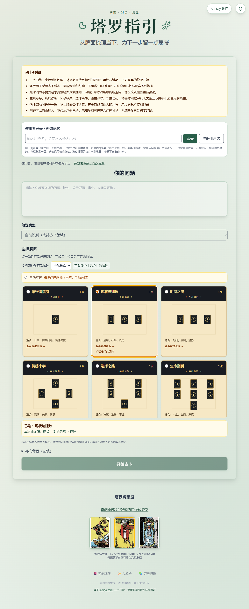
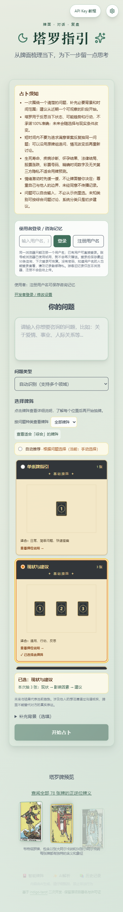
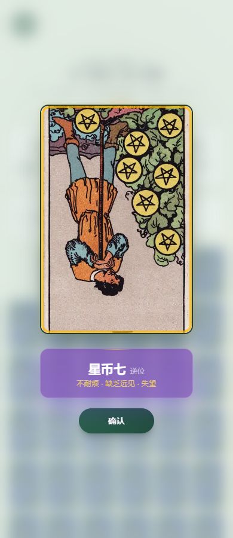

# 墨绿暖金主题验收

本文负责本次视觉截图与实际验证记录。项目来源及贡献范围以根目录 README 为准，授权以 LICENSE 与各素材来源为准。

统一墨绿主色、米白浅色背景、暖金点缀及结果页深绿背景；保留既有主题变量和工具类名称以避免改动业务逻辑。标题采用系统衬线字体，使用牌面、对话与复盘的表达，首页底部展示上游链接。移动标题区留出空间，避免与顶部API设置按钮重叠。

类型检查、相关ESLint通过；首页、抽牌、结果页38项回归和5项样式契约通过。生产构建通过。Edge浏览器1280px和390px视口实测greenHeading=true、attribution=true、deck=78、flip=true、overflow=false、errors=0。未调用付费模型；移动视口不代表实体手机完整验收。

视觉差异不构成独立原创或版权判断。此版本基于 indigo-tarot；保留署名和许可证，新增功能应结合提交与代码说明，不能把上游代码全部宣称为本人独立实现。本次未发布GitHub，完整历史脱敏和素材权属检查不在本次范围。

